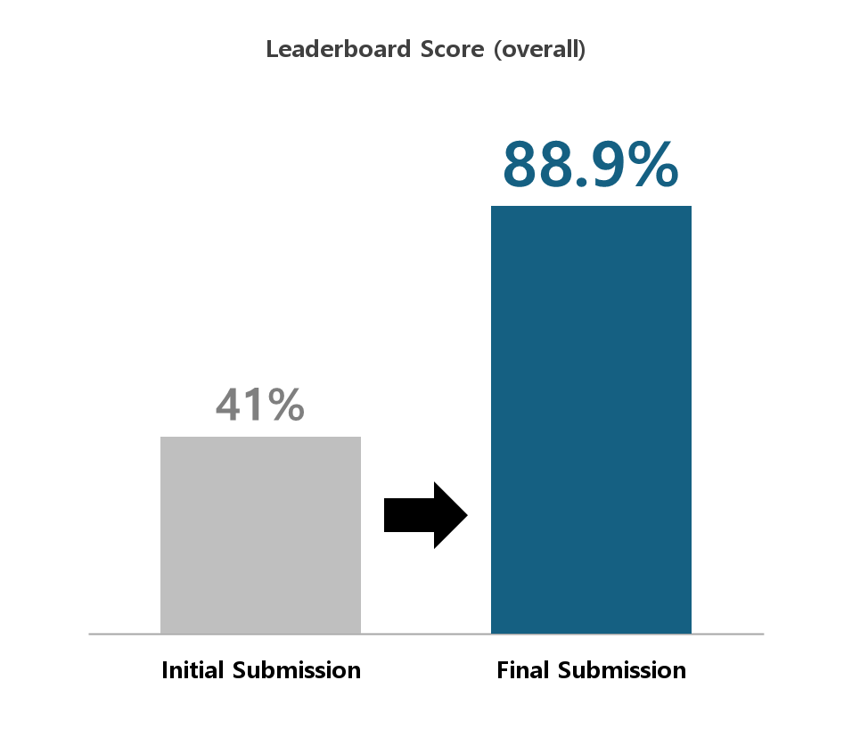
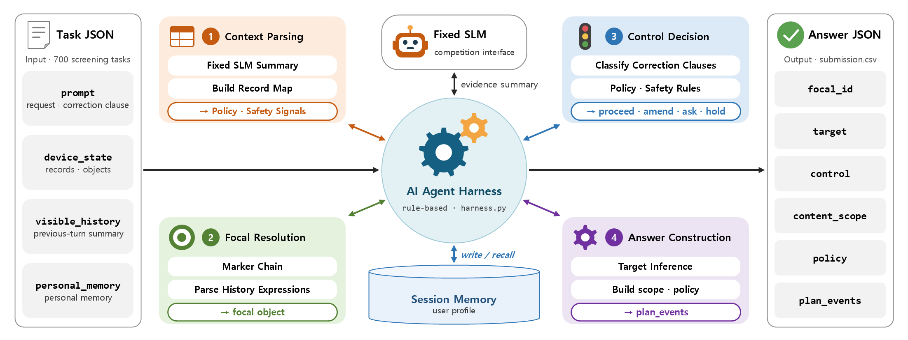
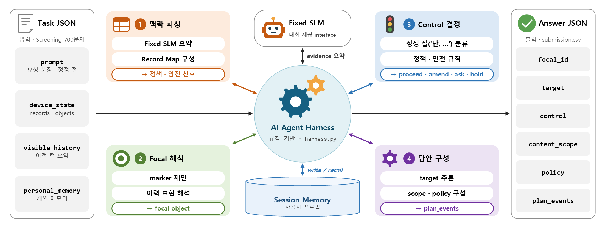

# 2026 Samsung AI Challenge – AI Agent Harness

**English** | [한국어](#한국어)

## Project Overview & Key Results
This repository shares the code of a **rule-based AI Agent Harness** that I designed and built for the [2026 Samsung Collegiate Programming Challenge: AI Challenge](https://dacon.io/competitions/official/236730/overview/description). The harness interprets the context of requests that an on-device personal agent receives, and produces its decision and execution plan as an answer in a fixed format.

- `harness.py` builds a structured answer through a single call, `FinalHarness.answer_task(task, session)`, by interpreting the task's `prompt`, `device_state` (objects · records), `visible_history`, `personal_memory`, and the session state. It is a deterministic implementation that uses **only the Python standard library**, with no external LLM/API.
- `run_submission.py` sorts the task JSONL by `(session_id, turn_index, task_id)`, runs the harness while keeping per-session state, validates the answer structure, and writes `submission.csv`.
- `evaluate_dev.py` is a regression check script for the public dev data. (It needs the local scoring code provided by the competition, which is not included in this repository.)

### Final Results
Raised the leaderboard score (overall) from **0.41 → 0.8891**, ranking **46th out of 1,843 participants (top 3%)**.

<p align="center">
  
</p>

---

## Task Overview
- **Topic**: Creative problem solving through AI Agent Harness design (Host: Samsung Electronics / Organizer: Samsung Research / Operator: DACON)
- **Input (task JSON)**: `prompt`, `device_state` (`objects`, `records`), `visible_history`, `personal_memory`
- **Output (answer JSON)**: `focal_id`, `target`, `control` (`proceed | amend | hold | ask`), `content_scope`, `policy`, `plan_events`
- **Evaluation**: Overall score computed by comparing the answers for the 700 Public Screening tasks with the ground truth stored on the server
- **Constraints**: Only the fixed SLM interface provided by the competition (`FixedSLMClient`) may be used; external LLM APIs, network calls, and hard-coding for specific tasks are not allowed. So performance differences come from **harness design**, not from the model.

---

## Repository Structure
```
2026_Samsung_AI_Challenge/
├── harness.py            # FixedSLMClient facade + FinalHarness (rule-based agent harness)
├── run_submission.py     # Run task JSONL → validate answer structure → write submission.csv
├── evaluate_dev.py       # Regression check on dev data (needs the competition-provided local scoring code)
├── requirements.txt      # No external dependencies (standard library only)
├── assets/               # Diagrams for the README
├── .gitignore / LICENSE
└── README.md
```

---

## Tech Stack
- **Language**: Python 3.10+ (environment used to create and validate the submission: Python 3.12.13)
- **Modules used**: Standard library modules such as `re`, `json`, `csv`, `argparse`, `pathlib`, and `typing`
- **External models/APIs**: None (only the competition-provided `FixedSLMClient` local facade)
- **Reproducibility**: Deterministic execution with no randomness or sampling (same input → same `submission.csv`)

---

## Dataset
The competition data (`dev_tasks.jsonl` with 120 tasks, `dev_answers.json`, `screening_tasks.jsonl` with 700 tasks, `submission_schema.json`, the baseline notebook, etc.) cannot be redistributed under the competition rules, so it is **not included in this repository.** Download it from the Data tab of the [competition page](https://dacon.io/competitions/official/236730/overview/description).

> **Note:** This repository is maintained **for sharing code**. To run it, prepare the competition data locally and pass the paths as arguments.

---

## Harness Architecture and Flow

<p align="center">
  
</p>

1. **Context parsing**
   - Summarizes the task's supporting evidence (risk flags, audit tags, etc.) with `FixedSLMClient.summarize_task()`. This result is used only for the answer's `audit_tags`; all other structured fields are built directly by the harness rules.
   - Converts `device_state.records` into a `type → value` Record Map to read sharing policies, permission checks, and safety/security signals.
2. **Focal resolution (`choose_focal`)**
   - ① The marker chain (`focal_marker_refs` → `focal_resolution_trace` → `route_binding_order`)
   - ② Designating expressions ("기준 참조는 …" / "the reference is …", "…로 고정" / "fixed to …") and ordinal expressions ("두 번째 후보만" / "only the second candidate", "가운데 항목만" / "only the middle item") in `visible_history`
   - ③ Object ids that record values point to directly → ④ token overlap with the prompt; the focal object is decided by checking these in this order.
3. **Control decision (priority cascade)**
   - Classifies the latest correction clause of the form "단, …" ("However, …") into one of four meanings: **stop / ask the user / process locally / summary only**.
   - Then picks one of `proceed | amend | hold | ask`, checking in this order: safety · security · consent → memory conflict · target change → authority → ambiguity → sharing policy.
4. **Answer construction**
   - `infer_target`: Decides the final target, such as the recipient, channel, device, or memory store
   - `build_content_scope`: Disclosure scope (mode), allowed/excluded fields, and whether user confirmation is needed
   - `build_policy`: risk flags, violations, confirmation
   - `build_plan_events`: Plan steps — read / guard / clarify / redact / summarize / dispatch / verify / update
5. **Session Memory**
   - Stores the user profile from `persistent_memory_write` records, then in later turns looks it up for `persistent_memory_recall` by `memory_key` → person, and reflects it in the target and control decisions.

---

## Improvement Process
| Stage | Leaderboard overall | Notes |
|------|-----------------:|------|
| Initial submission | 0.41 | First submission |
| Rules fitted to dev answers | 0.63 | Perfect local score (0.96) on the 120 dev tasks, but it did not generalize on the leaderboard |
| Redesign for generalization (final) | **0.8891** | Decisions based on structured records and meaning-level classification instead of memorized sentences |

- **Overfitting diagnosis**: The local scorer is gated: if the focal is wrong, every other field scores 0, and if the target or control is wrong, content_scope, policy, and plan score 0. Rules fitted to the dev example sentences lost all downstream points as soon as an earlier stage was wrong.
- **Redesign direction**
  - Classify the meaning of correction clauses (stop · confirm · local · summary only) by keyword combinations instead of memorizing them sentence by sentence
  - Turn focal resolution into general rules based on the marker chain and history expressions (designating · ordinal)
  - Treat record values with the same meaning as one (e.g., both `internal_binding_confirmed` and `local_authority_confirmed` mean "authority confirmed")
  - When a record value holds only an identifier, parse the user profile from the prompt and store it in session memory

---

## Usage
1. **Environment setup**
   ```bash
   python --version   # 3.10 or higher
   ```
   No extra packages need to be installed.
2. **Prepare the data**
   - Download `screening_tasks.jsonl` (required) and `dev_tasks.jsonl` · `dev_answers.json` (optional) from the competition Data tab.
3. **Create the submission file**
   ```bash
   python run_submission.py /path/to/screening_tasks.jsonl -o submission.csv
   ```
   On success it prints `wrote submission.csv (700 answers)`. Before saving, it checks that task IDs match, that the focal object exists, required fields and enums, scope/policy types, and the plan event structure.
4. **Dev regression check (optional)**
   ```bash
   python evaluate_dev.py /path/to/dev_tasks.jsonl /path/to/dev_answers.json
   ```
   To run it, save the local scoring code from the competition baseline notebook as `scoring.py` in the same folder.
5. **Call it directly from code**
   ```python
   from harness import FinalHarness

   harness = FinalHarness()
   session = {}
   answer = harness.answer_task(task, session)
   ```

---

## Reproducibility Check
- **Possible**: With the competition data (`screening_tasks.jsonl`, etc.) prepared locally and its path passed as an argument, you can create the submission file and validate its structure.
- **Not possible**: It cannot run without the data. The dev regression check also needs the competition-provided local scoring code. (The repository is for sharing code.)

---

## Key Results
- **Leaderboard overall**: `0.8891` (700 Public Screening tasks)
- **Rank**: 46th out of 1,843 (top 3%)
- **Dev regression check**: local score `0.9600` — the local scorer does not score the semantic response axis (0.04), so 0.96 is the maximum.
- **Implementation**: No external model, API, or network calls / no answer mapping by task_id or session_id / deterministic execution

---

# 한국어

## 프로젝트 소개 & 주요 성과
[2026 Samsung Collegiate Programming Challenge : AI 챌린지](https://dacon.io/competitions/official/236730/overview/description)에 참가하여, 개인 기기 Agent가 마주치는 요청 맥락을 해석하고 판단과 실행 계획을 정해진 형식의 답안으로 생성하는 **규칙 기반 AI Agent Harness**를 설계·구현한 코드를 공유합니다.

- `harness.py`는 `FinalHarness.answer_task(task, session)` 하나로 task의 `prompt`, `device_state`(objects·records), `visible_history`, `personal_memory`와 세션 상태를 해석해 구조화된 답안을 만듭니다. 외부 LLM/API 없이 **Python 표준 라이브러리만** 사용하는 결정론적 구현입니다.
- `run_submission.py`는 task JSONL을 `(session_id, turn_index, task_id)` 순으로 정렬하고, 세션별 상태를 유지하며 Harness를 실행한 뒤, 답안 구조를 검증하고 `submission.csv`를 생성합니다.
- `evaluate_dev.py`는 공개 dev 데이터에 대한 회귀 검증 스크립트입니다. (대회에서 제공한 로컬 채점 코드가 필요하며, 해당 코드는 리포지터리에 포함하지 않았습니다.)

### 최종 성과
리더보드 점수(overall)를 **0.41 → 0.8891** 로 향상시켰으며, 전체 1,843명 중 **46위(상위 3%)** 를 기록했습니다.

<p align="center">
  
</p>

---

## 과제 개요
- **주제**: AI Agent Harness 설계를 통한 창의적 문제 해결 (주최: 삼성전자 / 주관: 삼성리서치 / 운영: 데이콘)
- **입력 (task JSON)**: `prompt`, `device_state`(`objects`, `records`), `visible_history`, `personal_memory`
- **출력 (answer JSON)**: `focal_id`, `target`, `control`(`proceed | amend | hold | ask`), `content_scope`, `policy`, `plan_events`
- **평가**: Public Screening 700개 과제의 답안을 서버에 보관된 정답과 비교해 산출한 overall 점수
- **제약**: 대회가 제공하는 fixed SLM interface(`FixedSLMClient`)만 사용할 수 있고, 외부 LLM API·네트워크 호출과 특정 task에 대한 하드코딩은 금지됩니다. 따라서 성능 차이는 모델이 아니라 **Harness 설계**에서 나옵니다.

---

## 리포지터리 구성
```
2026_Samsung_AI_Challenge/
├── harness.py            # FixedSLMClient facade + FinalHarness (규칙 기반 Agent Harness)
├── run_submission.py     # task JSONL 실행 → 답안 구조 검증 → submission.csv 생성
├── evaluate_dev.py       # dev 데이터 회귀 검증 (대회 제공 로컬 채점 코드 필요)
├── requirements.txt      # 외부 의존성 없음 (표준 라이브러리만 사용)
├── assets/               # README용 다이어그램
├── .gitignore / LICENSE
└── README.md
```

---

## 기술 스택
- **언어**: Python 3.10+ (제출물 생성·검증 환경: Python 3.12.13)
- **사용 모듈**: `re`, `json`, `csv`, `argparse`, `pathlib`, `typing` 등 표준 라이브러리
- **외부 모델/API**: 사용하지 않음 (대회 제공 `FixedSLMClient` local facade만 사용)
- **재현성**: 난수·샘플링이 없는 결정론적 실행 (동일 입력 → 동일 `submission.csv`)

---

## 데이터셋
대회 데이터(`dev_tasks.jsonl` 120문항, `dev_answers.json`, `screening_tasks.jsonl` 700문항, `submission_schema.json`, baseline 노트북 등)는 대회 규정상 재배포할 수 없어 **리포지터리에 포함되어 있지 않습니다.** [대회 페이지](https://dacon.io/competitions/official/236730/overview/description)의 데이터 탭에서 내려받아야 합니다.

> **주의:** 본 리포지터리는 **코드 공유 목적**으로 유지됩니다. 실행하려면 대회 데이터를 로컬에 준비하고 경로를 인자로 넘겨야 합니다.

---

## Harness 구조 및 동작 흐름

<p align="center">
  
</p>

1. **맥락 파싱**
   - `FixedSLMClient.summarize_task()`로 task의 보조 evidence(risk flag, audit tag 등)를 요약합니다. 이 결과는 답안의 `audit_tags`에만 쓰이고, 나머지 구조 필드는 모두 Harness의 규칙이 직접 만듭니다.
   - `device_state.records`를 `type → value` 형태의 Record Map으로 바꿔 공유 정책, 권한 확인, 안전·보안 신호를 읽습니다.
2. **Focal 해석 (`choose_focal`)**
   - ① marker 체인(`focal_marker_refs` → `focal_resolution_trace` → `route_binding_order`)
   - ② `visible_history`의 지정형 표현("기준 참조는 …", "…로 고정")과 서수형 표현("두 번째 후보만", "가운데 항목만")
   - ③ record 값이 직접 가리키는 object id → ④ prompt 토큰 겹침 순으로 중심 object를 결정합니다.
3. **Control 결정 (우선순위 cascade)**
   - "단, …" 형태의 최신 정정 절을 **중단 / 사용자 확인 / 로컬 처리 / 요약 한정** 네 가지 의미로 분류합니다.
   - 이어서 안전·보안·동의 → 메모리 충돌·대상 변경 → 권한(authority) → 모호성 → 공유 정책 순으로 `proceed | amend | hold | ask` 중 하나를 정합니다.
4. **답안 구성**
   - `infer_target`: 수신처·채널·장치·메모리 저장소 등 최종 대상 결정
   - `build_content_scope`: 공개 범위(mode), 허용·제외 필드, 사용자 확인 필요 여부
   - `build_policy`: risk flags, violations, confirmation
   - `build_plan_events`: read / guard / clarify / redact / summarize / dispatch / verify / update 계획 단계
5. **Session Memory**
   - `persistent_memory_write` record의 사용자 프로필을 저장해 두고, 이후 turn의 `persistent_memory_recall`에서 `memory_key` → person 순으로 조회해 target과 control 판단에 반영합니다.

---

## 개선 과정
| 단계 | 리더보드 overall | 내용 |
|------|-----------------:|------|
| 초기 제출 | 0.41 | 첫 제출 |
| dev 정답에 맞춘 규칙 | 0.63 | dev 120문항에서는 로컬 채점 만점(0.96)이었지만 리더보드에서는 일반화되지 않음 |
| 일반화 재설계 (최종) | **0.8891** | 문장 암기 대신 구조화 record와 의미 단위 분류로 판단 |

- **과적합 진단**: 로컬 채점은 focal이 틀리면 나머지 항목이 모두 0점이 되고, target·control이 틀리면 content_scope·policy·plan이 0점이 되는 게이팅 구조입니다. dev 예시 문장에 맞춘 규칙은 앞 단계에서 한 번 틀리면 뒤 항목 점수를 모두 잃었습니다.
- **재설계 방향**
  - 정정 절을 문장 단위로 외우지 않고, 키워드 조합으로 의미(중단·확인·로컬·요약 한정)를 분류
  - focal을 marker 체인과 이력 표현(지정형·서수형)으로 해석하는 일반 규칙으로 정리
  - 같은 의미를 가진 record 값을 하나로 묶어 처리 (예: `internal_binding_confirmed`와 `local_authority_confirmed`를 모두 "권한 확정"으로 취급)
  - record 값이 식별자만 담고 있을 때는 prompt에서 사용자 프로필을 파싱해 세션 메모리에 저장

---

## 사용 방법
1. **환경 구성**
   ```bash
   python --version   # 3.10 이상
   ```
   별도 패키지 설치는 필요하지 않습니다.
2. **데이터 준비**
   - 대회 데이터 탭에서 `screening_tasks.jsonl`(필수), `dev_tasks.jsonl`·`dev_answers.json`(선택)을 내려받습니다.
3. **제출 파일 생성**
   ```bash
   python run_submission.py /path/to/screening_tasks.jsonl -o submission.csv
   ```
   정상 완료 시 `wrote submission.csv (700 answers)`가 출력됩니다. 저장 전에 task ID 일치, focal object 존재 여부, 필수 필드와 enum, scope/policy 타입, plan event 구조를 검사합니다.
4. **dev 회귀 검증 (선택)**
   ```bash
   python evaluate_dev.py /path/to/dev_tasks.jsonl /path/to/dev_answers.json
   ```
   대회 baseline 노트북에 포함된 로컬 채점 코드를 `scoring.py`로 같은 폴더에 두어야 실행됩니다.
5. **코드에서 직접 호출**
   ```python
   from harness import FinalHarness

   harness = FinalHarness()
   session = {}
   answer = harness.answer_task(task, session)
   ```

---

## 실험 가능 여부 체크
- **가능**: 대회 데이터(`screening_tasks.jsonl` 등)를 로컬에 준비하고 경로를 인자로 넘기면 제출 파일 생성과 구조 검증이 가능합니다.
- **불가능**: 데이터가 없는 상태에서는 실행할 수 없습니다. dev 회귀 검증은 대회 제공 로컬 채점 코드가 있어야 합니다. (리포지터리는 코드 공유 목적)

---

## 핵심 결과
- **리더보드 overall**: `0.8891` (Public Screening 700개 과제)
- **순위**: 1,843명 중 46위 (상위 3%)
- **dev 회귀 검증**: 로컬 채점 `0.9600` — 로컬 채점기는 semantic response 축(0.04)을 채점하지 않아 0.96이 최댓값입니다.
- **구현 특징**: 외부 모델·API·네트워크 호출 없음 / task_id·session_id별 정답 매핑 없음 / 결정론적 실행

---
